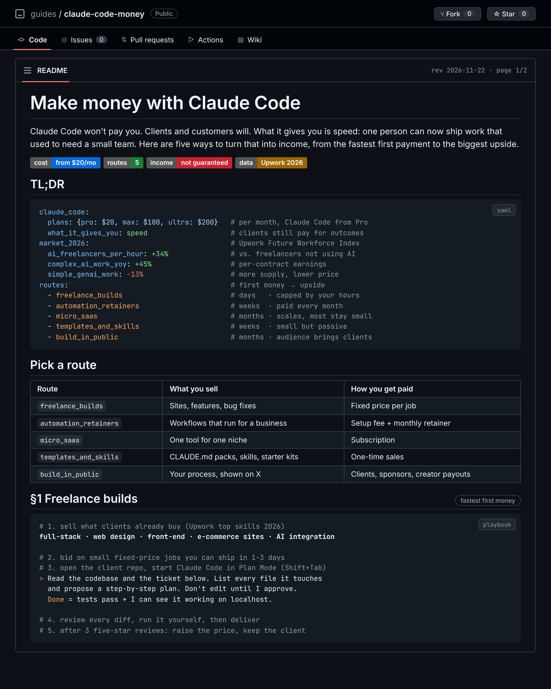
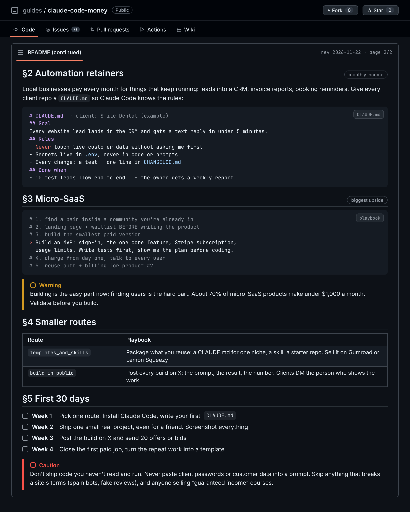

# Make money with Claude Code

Claude Code won't pay you. Clients and customers will. What it gives you is speed: one person can now ship work that used to need a small team. Here are five ways to turn that into income, from the fastest first payment to the biggest upside.


## TL;DR

```yaml
claude_code:
  plans: {pro: $20, max: $100, ultra: $200}  # per month, Claude Code from Pro
  what_it_gives_you: speed                   # clients still pay for outcomes
market_2026:                                 # Upwork Future Workforce Index
  ai_freelancers_per_hour: +34%              # vs. freelancers not using AI
  complex_ai_work_yoy: +45%                  # per-contract earnings
  simple_genai_work: -13%                    # more supply, lower price
routes:                                      # first money → upside
  - freelance_builds                         # days   · capped by your hours
  - automation_retainers                     # weeks  · paid every month
  - micro_saas                               # months · scales, most stay small
  - templates_and_skills                     # weeks  · small but passive
  - build_in_public                          # months · audience brings clients
```

## Pick a route

| Route | What you sell | How you get paid |
| --- | --- | --- |
| `freelance_builds` | Sites, features, bug fixes | Fixed price per job |
| `automation_retainers` | Workflows that run for a business | Setup fee + monthly retainer |
| `micro_saas` | One tool for one niche | Subscription |
| `templates_and_skills` | CLAUDE.md packs, skills, starter kits | One-time sales |
| `build_in_public` | Your process, shown on X | Clients, sponsors, creator payouts |

## §1 Freelance builds (fastest first money)

```text
# 1. sell what clients already buy (Upwork top skills 2026)
full-stack · web design · front-end · e-commerce sites · AI integration

# 2. bid on small fixed-price jobs you can ship in 1-3 days
# 3. open the client repo, start Claude Code in Plan Mode (Shift+Tab)
#    and paste the prompt from templates/prompts.md → "Client ticket"
# 4. review every diff, run it yourself, then deliver
# 5. after 3 five-star reviews: raise the price, keep the client
```

> [!NOTE]
> Simple AI output is getting cheaper. On Upwork, generative and creative contracts paid 13% less per contract, while complex AI work paid 45% more. Sell the hard part.

## §2 Automation retainers (monthly income)

Local businesses pay every month for things that keep running: leads into a CRM, invoice reports, booking reminders. Give every client repo a `CLAUDE.md` so Claude Code knows the rules. A ready template is in [`templates/CLAUDE.md`](templates/CLAUDE.md).

```markdown
# CLAUDE.md · client: Smile Dental (example)
## Goal
Every website lead lands in the CRM and gets a text reply in under 5 minutes.
## Rules
- Never touch live customer data without asking me first
- Secrets live in .env, never in code or prompts
- Every change: a test + one line in CHANGELOG.md
## Done when
- 10 test leads flow end to end
- the owner gets a weekly report
```

## §3 Micro-SaaS (biggest upside)

```text
# 1. find a pain inside a community you're already in
# 2. landing page + waitlist BEFORE writing the product
# 3. build the smallest paid version: prompt "MVP" in templates/prompts.md
# 4. charge from day one, talk to every user
# 5. reuse auth + billing for product #2
```

> [!WARNING]
> Building is the easy part now; finding users is the hard part. About 70% of micro-SaaS products make under $1,000 a month. Validate before you build.

## §4 Smaller routes

| Route | Playbook |
| --- | --- |
| `templates_and_skills` | Package what you reuse: a CLAUDE.md for one niche, a skill, a starter repo. Sell it on Gumroad or Lemon Squeezy |
| `build_in_public` | Post every build on X: the prompt, the result, the number. Clients DM the person who shows the work |

## §5 First 30 days

- [ ] **Week 1** Pick one route. Install Claude Code, write your first `CLAUDE.md`
- [ ] **Week 2** Ship one small real project, even for a friend. Screenshot everything
- [ ] **Week 3** Post the build on X and send 20 offers or bids
- [ ] **Week 4** Close the first paid job, turn the repeat work into a template

> [!CAUTION]
> Don't ship code you haven't read and run. Never paste client passwords or customer data into a prompt. Skip anything that breaks a site's terms (spam bots, fake reviews), and anyone selling "guaranteed income" courses.

## What's in this repo

```text
claude-code-money/
├── README.md              this guide
├── templates/
│   ├── CLAUDE.md          drop into any client repo, fill the blanks
│   └── prompts.md         copy-paste prompts for Claude Code
└── assets/                the guide as two images
```

## Guide as images

| Page 1 | Page 2 |
| --- | --- |
|  |  |

## Sources

- [Claude plans & pricing](https://claude.com/pricing)
- [Upwork Future Workforce Index 2026](https://www.upwork.com/research/research-future-workforce-index-2026)
- [Upwork In-Demand Skills 2026](https://upwork.com/research/in-demand-skills-2026)
- [Staffing Industry Analysts: per-contract earnings for generative vs. complex AI work](https://www.staffingindustry.com/news/global-daily-news/skilled-ai-freelancing-becomes-more-abundant-lucrative)
- [The Micro SaaS Playbook (70% under $1,000/month)](https://www.alexcloudstar.com/blog/micro-saas-playbook-developer-guide-2026/)

---

Last verified 2026-11-22. Not affiliated with Anthropic or Upwork. Income is never guaranteed.
